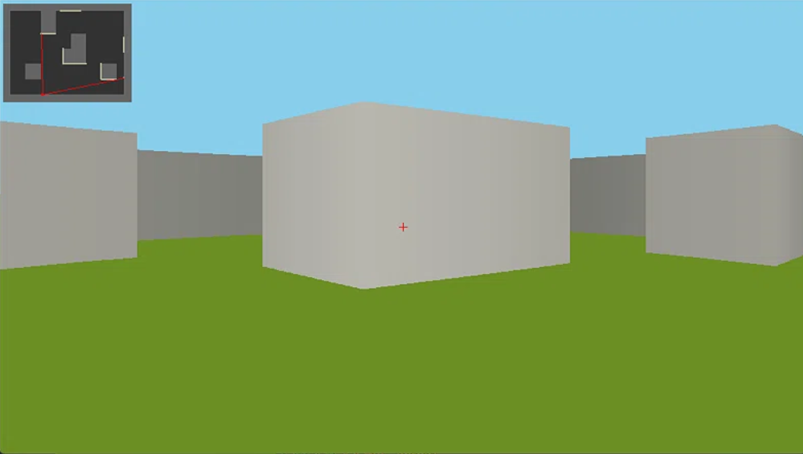

# Fake3D

## Fake3D是什么？

Fake3D将一个**二维数组**作为地图然后通过 ***光线投射算法*** 和 ***鱼眼矫正算法*** 绘制出**3D效果**的项目。



## 核心特性与算法优化

不同于常规光线投射（Raycasting）教程中使用的 DDA 逐格步进法，本项目在核心算法上进行了定制化的设计与优化：

- **网格线求交（Grid Intersection）**：放弃性能低下的逐格试探，利用二维数组地图中“墙体天然位于网格线上”的特性，直接通过 Bresenham 变体算法计算射线与网格线的交点，大幅减少了计算量，且避免了精细度不足导致的漏墙问题。

- **自适应射线投射**：根据屏幕像素列数与视野角度（FOV），动态计算每一列像素对应的射线角度，确保渲染视野与分辨率完美映射。

- **降采样**：为降低计算负担，每 3 列像素计算一条射线（`RAY_STEP = 3`），在性能与画面质量之间取得平衡。

- **2.5D 物理引擎**：内置了基于运动学公式（`x = v0*t + 1/2at^2`）的跳跃系统、平滑的下蹲偏移，以及基于四边界距离排序的墙体碰撞滑行（Collision Sliding）逻辑。

- **重写贪心抗锯齿**。早期版本曾实现过基于预存与贪心的抗锯齿逻辑，但受限于早期不懂git操作而丢失。计划在后续版本中重新实现。

## 技术栈

- **语言**：Python 3.10+
- **图形库**：pygame-ce
- **核心算法**：Raycasting, Bresenham, 矩阵投影

## 如何启动？

### 使用conda

```
# 1. 创建并激活虚拟环境（推荐 Python 3.10 - 3.12）
conda create -n fake3d python=3.11 -y
conda activate fake3d

# 2. 安装依赖
pip install pygame-ce

# 3. 运行项目
python src/main.py
```

### 使用 Python venv

#### Windows (CMD / PowerShell)

```
# 1. 创建虚拟环境
python -m venv venv

# 2. 激活虚拟环境
.\venv\Scripts\activate

# 3. 安装依赖
pip install pygame-ce

# 4. 运行项目
python src/main.py
```

#### Linux / macOS:

```
# 1. 创建虚拟环境
python3 -m venv venv

# 2. 激活虚拟环境
source venv/bin/activate

# 3. 安装依赖
pip install pygame-ce

# 4. 运行项目
python src/main.py
```

### 直接使用全局python运行

```
pip install pygame-ce
python src/main.py
```


## 项目结构

```text
Fake3D/
├── src/
│   ├── core/                 # 核心逻辑层（引擎、状态、输入）
│   │   ├── __init__.py
│   │   ├── engine.py         # 物理引擎：移动、跳跃、碰撞滑行检测
│   │   ├── game_state.py     # 全局数据层：地图数组、玩家坐标、按键状态
│   │   └── input_event.py    # 事件处理：监听键盘鼠标输入并更新状态
│   │
│   ├── render/               # 渲染层（数学计算与画面绘制）
│   │   ├── __init__.py
│   │   ├── calculate.py      # 核心算法：Bresenham 网格求交、透视/鱼眼修正
│   │   ├── controller.py     # 渲染控制器：计算并分发所有射线数据
│   │   └── draw.py           # 绘制模块：绘制 3D 墙块、小地图、准星
│   │
│   ├── __init__.py
│   ├── config.py             # 配置文件：分辨率、FOV、物理参数、RAY_STEP 等常量
│   ├── main.py               # 主程序入口：pygame 初始化与游戏主循环
│   └── utils.py              # 工具函数：坐标转换、线段相交判断等
│
└── test.py                   # 本地调试与算法测试脚本（一般为空）
```


